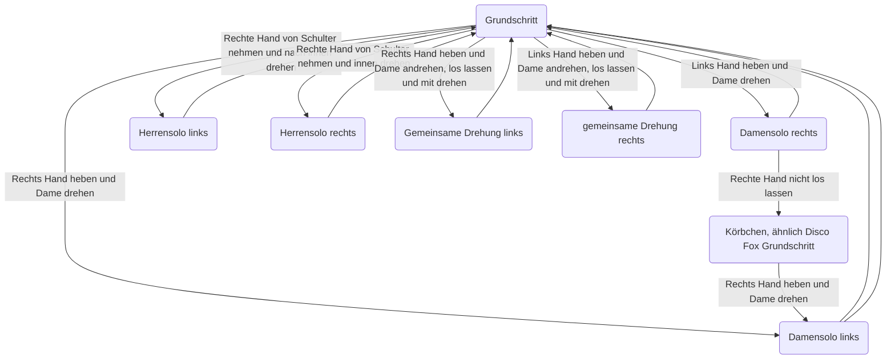

# Bachata

<a href="../overview-de.md">Zurück zur Übersicht der Tänze</a>

## Playlist:

<a href="https://open.spotify.com/playlist/60FK3V4NoBDEqvl5ifAPB9?si=qxfK_TGNR_qthvfkpzrNdQ">Bachata</a>

## Figuren

