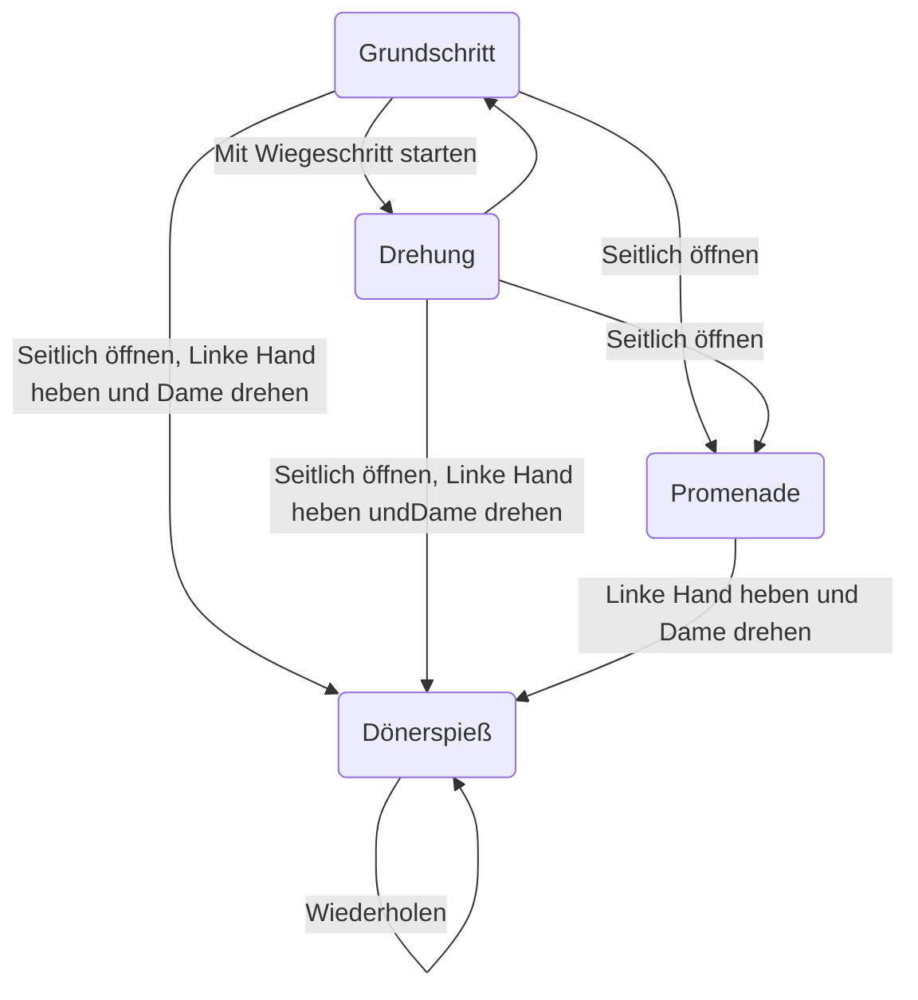

# Fox Trott

<a href="../overview-de.md">Zurück zur Übersicht der Tänze</a>

## Playlist:

<a href="https://open.spotify.com/playlist/1i6KGCWE6Xd2eM3FHY5Ewl?si=oRCDo5E1T12MVThX__vW-g">Foxtrott</a>

## Figuren

