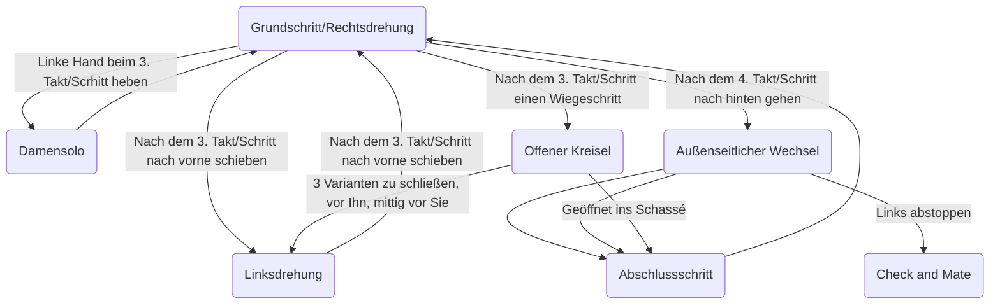

# Langsamer Walzer

<a href="../overview-de.md">Zurück zur Übersicht der Tänze</a>

## Playlist:

<a href="https://open.spotify.com/playlist/2rXfise9RzKMJdQlgqQ43r?si=wToVcbbRRhKUsEaJL_Ctcw">LaWa</a>

## Figuren

