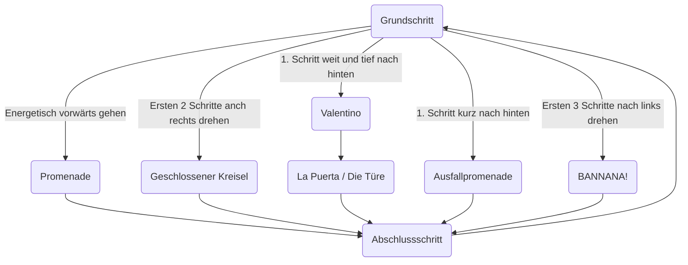

# Tango

<a href="../overview-de.md">Zurück zur Übersicht der Tänze</a>

## Playlist:

<a href="https://open.spotify.com/playlist/0eiM3NgZsXrrQDggYQS4rx?si=8vwr3vwRTt66yqdLEA-mBQ">Tango</a>

## Figuren

