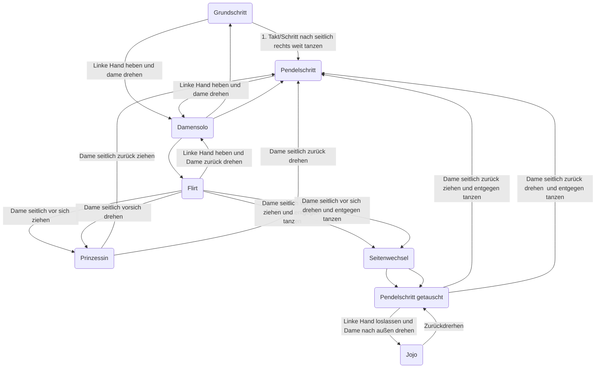

# Wiener Walzer

<a href="../overview-de.md">Zurück zur Übersicht der Tänze</a>

## Playlist:

<a href="https://open.spotify.com/playlist/1LtehkwkjkcQQLdtFIQKaw?si=8ymvWf97Tdq9Z4yfrlduSg">WiWa</a>

## Figuren

